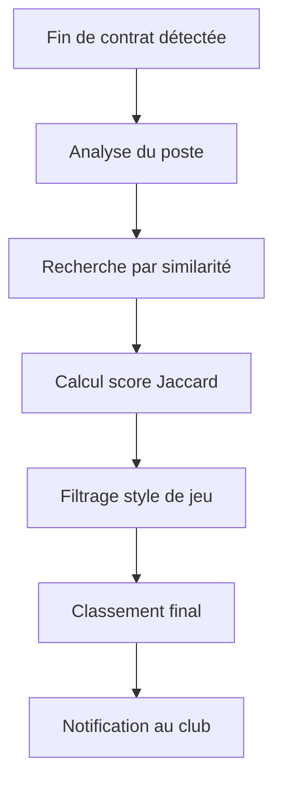

## 1. Vue d'ensemble du produit

Scouting Assistant est une plateforme intelligente d'aide à la décision pour les clubs de football de la Botola Pro. Le système analyse automatiquement les fins de contrat et recommande des joueurs similaires basés sur des critères techniques multidimensionnels.

Objectif : Optimiser les campagnes de recrutement en fournissant des suggestions pertinentes et contextualisées de remplaçants potentiels.

## 2. Fonctionnalités principales

### 2.1 Rôles utilisateurs

| Rôle | Méthode d'inscription | Permissions principales |
|------|---------------------|------------------------|
| Club Manager | Inscription via email vérifiée | Accès complet à toutes les fonctionnalités |
| Spectateur | Accès public limité | Visualisation uniquement des données publiques |

### 2.2 Modules fonctionnels

L'application Scouting Assistant comprend les pages principales suivantes :

1. **Page d'accueil** : Présentation du service, navigation principale, statistiques générales
2. **Tableau de bord Club** : Vue personnalisée des joueurs du club, alertes contrats
3. **Recommandations** : Liste des joueurs recommandés avec scores de pertinence
4. **Visualisation Graph** : Cartographie interactive des relations joueurs-clubs
5. **Gestion des joueurs** : CRUD complet sur les données joueurs
6. **Page de connexion** : Authentification sécurisée des clubs

### 2.3 Détails des pages

| Page | Module | Description fonctionnelle |
|------|--------|--------------------------|
| Accueil | Hero Section | Présentation visuelle du service avec couleurs Botola Pro |
| Accueil | Navigation | Menu principal vers toutes les sections |
| Accueil | Statistiques | Chiffres clés sur les recommandations effectuées |
| Tableau de bord | Alertes contrats | Liste des joueurs avec contrat expirant < 3 mois |
| Tableau de bord | Vue d'ensemble | Statistiques du club et joueurs actifs |
| Recommandations | Filtres | Sélection par poste, qualités, style de jeu |
| Recommandations | Résultats | Liste triée avec score de pertinence (%) |
| Recommandations | Détails joueur | Caractéristiques techniques complètes |
| Visualisation | Graph interactif | Exploration des relations joueurs-qualités-clubs |
| Gestion joueurs | CRUD | Ajout, modification, suppression des fiches joueurs |
| Connexion | Authentification | Formulaire sécurisé avec gestion des sessions |

## 3. Processus principaux

### Flux Club Manager
1. Connexion au tableau de bord personnel
2. Visualisation des alertes de fin de contrat
3. Clic sur "Voir recommandations" pour un joueur spécifique
4. Exploration des résultats avec filtres avancés
5. Analyse détaillée des profils recommandés
6. Visualisation graphique des relations

### Flux de recommandation automatique

## 4. Interface utilisateur

### 4.1 Style de design

- **Couleurs principales** : Vert Botola Pro (#1B5E20) et Orange secondaire (#FF6F00)
- **Style des boutons** : Boutons arrondis avec effet hover
- **Typographie** : Inter pour titres, Roboto pour contenu
- **Layout** : Design carte-based avec espacement généreux
- **Icônes** : Style Material Design avec couleurs de la Botola

### 4.2 Aperçu des pages

| Page | Module | Éléments UI |
|------|--------|-------------|
| Accueil | Hero Section | Background dégradé vert/orange, titre principal blanc, CTA prominent |
| Tableau de bord | Alertes | Cartes rouges pour urgences, cartes oranges pour avertissements |
| Recommandations | Résultats | Grille responsive, badges de score, photos joueurs rondes |
| Visualisation | Graph | Canvas interactif, nœuds colorés, transitions fluides |
| Connexion | Formulaire | Champs arrondis, bouton principal vert, lien mot de passe oublié |

### 4.3 Responsive

- Design desktop-first avec breakpoints adaptatifs
- Optimisation mobile avec menu hamburger
- Touch-friendly sur tablettes
- Chargement progressif des images

### 4.4 Visualisation 3D (Graph)

- **Environnement** : Studio avec fond sombre pour mettre en valeur les nœuds
- **Éclairage** : Key light doux, fill light bleuté, rim light pour séparation
- **Caméra** : FOV 60°, contrôles orbitaux libres, zoom smooth
- **Composition** : Nœuds joueurs en premier plan, clubs en arrière-plan
- **Interactions** : Hover scale, click focus, animations spring
- **Post-processing** : Bloom léger, SSAO subtil, depth of field sur détails