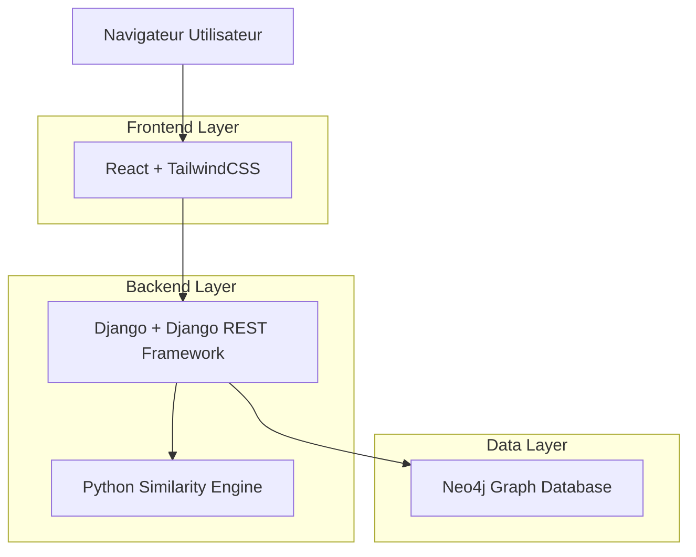
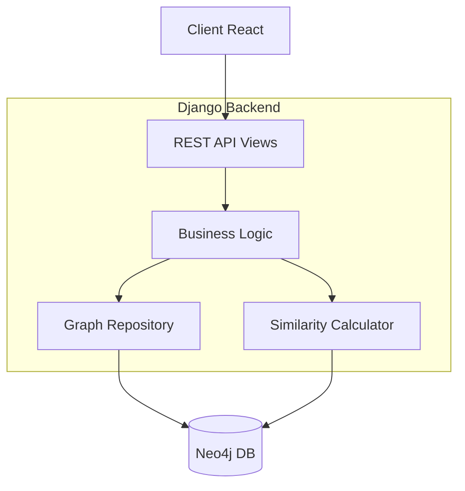
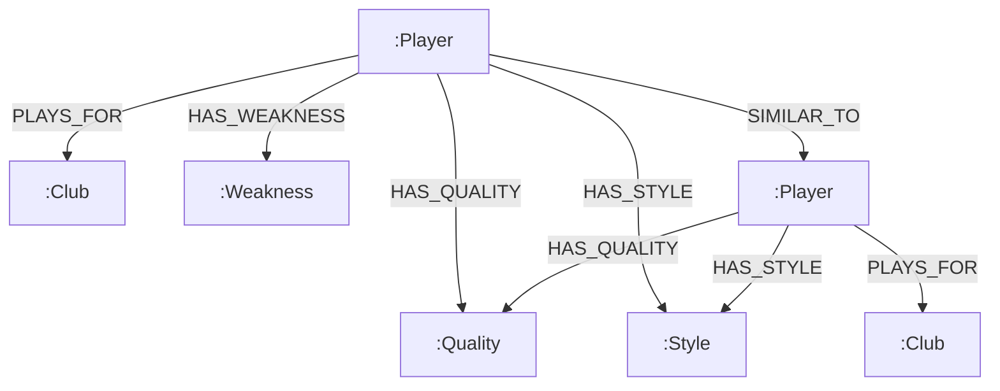

## 1. Architecture système



## 2. Description technologique

- **Frontend** : React@18 + TailwindCSS@3 + Vite
- **Outil d'initialisation** : vite-init
- **Backend** : Django@4 + Django REST Framework
- **Base de données** : Neo4j Graph Database
- **Visualisation** : Neovis.js / D3.js
- **ORM Neo4j** : Neomodel

## 3. Définitions des routes

| Route | Objectif |
|-------|----------|
| / | Page d'accueil publique |
| /login | Authentification club |
| /dashboard | Tableau de bord personnalisé |
| /players | Gestion des joueurs (CRUD) |
| /recommendations | Vue des recommandations |
| /visualization | Visualisation graphique interactive |
| /profile | Profil club et paramètres |

## 4. Définitions API

### 4.1 Authentification

```
POST /api/auth/login
```

**Requête :**
| Paramètre | Type | Requis | Description |
|-----------|------|--------|-------------|
| email | string | true | Email du club |
| password | string | true | Mot de passe |

**Réponse :**
```json
{
  "token": "jwt_token_here",
  "club_id": "uuid",
  "club_name": "Nom du Club"
}
```

### 4.2 Recommandations

```
GET /api/recommendations/{player_id}
```

**Paramètres URL :**
| Paramètre | Type | Requis | Description |
|-----------|------|--------|-------------|
| player_id | string | true | ID du joueur à remplacer |
| limit | integer | false | Nombre max de recommandations (défaut: 10) |

**Réponse :**
```json
{
  "recommendations": [
    {
      "player_id": "uuid",
      "name": "Nom Joueur",
      "position": "Attaquant",
      "similarity_score": 0.85,
      "qualities": ["Vitesse", "Dribble"],
      "style": "Offensif"
    }
  ]
}
```

### 4.3 Gestion des joueurs

```
POST /api/players
```

**Requête :**
| Paramètre | Type | Requis | Description |
|-----------|------|--------|-------------|
| name | string | true | Nom du joueur |
| age | integer | true | Âge |
| position | string | true | Poste |
| contract_end | date | true | Date fin contrat |
| club_id | string | true | Club actuel |

## 5. Architecture serveur



## 6. Modèle de données

### 6.1 Structure du graphe



### 6.2 Définition des nœuds

**Player Node Properties:**
```cypher
CREATE (p:Player {
    id: string,
    name: string,
    age: integer,
    position: string,
    nationality: string,
    contract_end: date,
    created_at: datetime
})
```

**Club Node Properties:**
```cypher
CREATE (c:Club {
    id: string,
    name: string,
    city: string,
    league: string,
    founded: integer
})
```

**Quality Node Properties:**
```cypher
CREATE (q:Quality {
    id: string,
    label: string,
    category: string
})
```

### 6.3 Requêtes Cypher principales

**Recherche de similarité par poste :**
```cypher
MATCH (target:Player {id: $player_id})-[:HAS_QUALITY]->(q:Quality)
MATCH (candidate:Player)-[:HAS_QUALITY]->(q)
WHERE target <> candidate AND target.position = candidate.position
RETURN candidate, count(q) as shared_qualities
ORDER BY shared_qualities DESC
LIMIT 10
```

**Calcul du score de similarité Jaccard :**
```cypher
MATCH (p1:Player {id: $player1_id})-[:HAS_QUALITY]->(q1:Quality)
MATCH (p2:Player {id: $player2_id})-[:HAS_QUALITY]->(q2:Quality)
WITH p1, p2, collect(q1) as qualities1, collect(q2) as qualities2
RETURN size([q IN qualities1 WHERE q IN qualities2]) * 1.0 / size(qualities1 + qualities2) as jaccard_score
```

### 6.4 Index et performance

```cypher
CREATE INDEX player_position_index FOR (p:Player) ON (p.position)
CREATE INDEX player_contract_index FOR (p:Player) ON (p.contract_end)
CREATE INDEX club_name_index FOR (c:Club) ON (c.name)
CREATE INDEX quality_label_index FOR (q:Quality) ON (q.label)
```